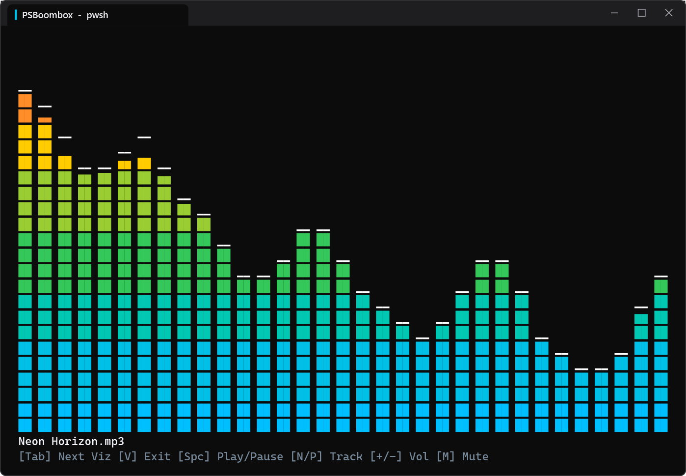
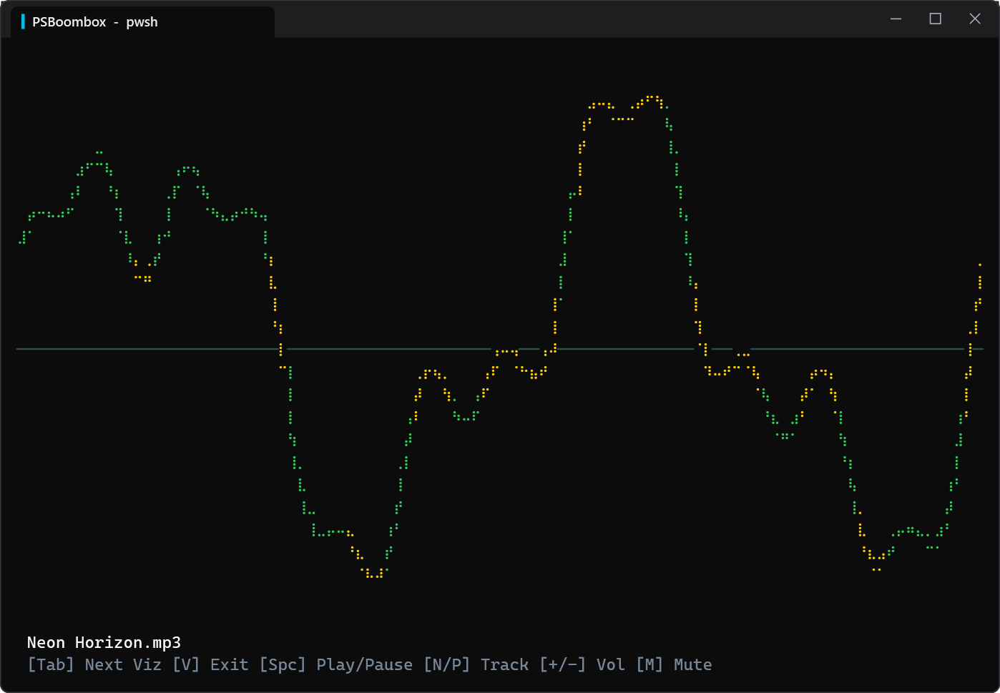

# PSBoombox


PSBoombox will let you boom that box, all in the terminal. Inspired by [MOC](https://terminaltrove.com/moc/), [CMUS](https://cmus.github.io/), and Winamp (because we still gotta whip that llama's azz).


---

## Features

- Plays audio files. Woooooo. Currently supports MP3, WAV, WMA, FLAC, M4A, AAC, MKA, and WEBA.
- 10-band equalizer with a few baked in presets and the ability to create your own.
- A fancy little Visualizer Mode. Because what the hell.
- Directory browsing with an in-memory playlist. Also supports saving and loading common playlist formats: M3U, M3U8, PLS, and WPL.
- Full-screen Dark & Light color theming powered by embedded Gogh palettes (plus `PSBoombox Default` and custom Gogh JSON files via `-Theme`), complete with a live-preview tabbed Theme Selector (`T`).
- Responsive layout. Will resize with the buffer window/pane. If the buffer drops below certain dimensions, you'll be smacked in your face.

---

## System & Software Requirements

| Requirement | Specification |
| --- | --- |
| **Operating System** | **Windows 10 / Windows 11** - Plans to look at Mac and Linux are forthcoming. |
| **PowerShell** | **PowerShell Core 7.0+** Windows PowerShell 5.1 is not supported and likely won't be. |
| **Terminal Emulator** | VT/ANSI terminal with **24-bit TrueColor**, **Unicode** glyph support, and synchronized rendering (**Windows Terminal** with `Cascadia Mono` or `Consolas` recommended). |
| **Terminal Size** | Minimum **80 × 24** cells. Layout scales. |
| **Audio Output** | Speakers. Your mouth isn't acceptable. |
| **Dependencies** | A computer, fingers to type with, brains. |

---

## Installation & Module Loading

PSBoombox is available on the PowerShell Gallery.

```powershell
Install-Module PSBoombox
```

Once installed, you import it, then run the `Start-PSBoombox` cmdlet:

```powershell
Import-Module PSBoombox
Start-PSBoombox
```

---

## Invocation

`PSBoombox` exports a single public cmdlet: `Start-PSBoombox`.

### Parameters

| Parameter | Type | Default | Description |
| --- | --- | --- | --- |
| `-Path` | `[String]` | Current Working Directory | Optional starting directory displayed in the Directory Browser pane (relative or rooted paths supported). If omitted, PSBoombox will use the current directory you started it from. |
| `-Playlist` | `[String]` | Empty (`''`) | Optional path to a `.m3u`, `.m3u8`, `.pls`, or `.wpl` playlist file to load on startup. If omitted, PSBoombox will use a default, empty, in-memory playlist. |
| `-Theme` | `[String]` | Persisted / `'PSBoombox Default'` | Optional built-in theme name (e.g. `'Catppuccin Latte'`, `'Dracula'`, `'Nord'`) or path to a custom Gogh-format `.json` color scheme file. |

### Startup Behavior

- **`Start-PSBoombox`** *(no arguments)*: Opens the Directory Browser in the current working directory, starts with an empty playlist, and automatically appends any supported audio files located in it.
- **`Start-PSBoombox -Path 'C:\Music'`**: Starts the Directory Browser in `C:\Music` and auto-populates the playlist with any supported audio files found there.
- **`Start-PSBoombox -Playlist '.\Favorites.m3u8'`**: Loads tracks from the specified playlist file on startup (bypassing CWD auto-population) and focuses the Playlist pane automatically when tracks are loaded.
- **`Start-PSBoombox -Theme 'Catppuccin Latte'`**: Launches PSBoombox with the specified built-in Gogh preset or custom Gogh `.json` theme file.

### Examples

```powershell
# Start in the current working directory (auto-adds any media files in CWD)
Start-PSBoombox

# Start in a specific music folder
Start-PSBoombox -Path 'D:\Audio\GoodShit'

# Start with a saved playlist loaded
Start-PSBoombox -Playlist '.\Playlists\PissMyNeighborsOffWithThis.m3u8'

# Browse one folder while pre-loading a playlist from elsewhere
Start-PSBoombox -Path 'D:\Audio' -Playlist 'D:\Playlists\Favorites.pls'

# Launch with a built-in Light theme or custom Gogh JSON file
Start-PSBoombox -Theme 'Catppuccin Latte'
Start-PSBoombox -Theme '.\my-custom-gogh-theme.json'
```

---

## Supported Formats

### Audio Formats

| Extension | Format | Caveats |
| --- | --- | --- |
| `.mp3` | MPEG Audio Layer III |  |
| `.wav` | RIFF WAVE PCM *(8/16/24/32-bit, up to 7.1 ch)* |  |
| `.wma` | Windows Media Audio |  |
| `.flac` | Free Lossless Audio Codec |  |
| `.m4a`, `.aac` | MPEG-4 Audio (AAC / ALAC) & ADTS AAC |  |
| `.mka`, `.weba` | Matroska / WebM Audio |  |
| `.mid`, `.midi` | Standard MIDI | Doesn't support EQ and Visualizer Mode |

### Playlist Formats

| Extension | Format | Notes |
| --- | --- | --- |
| `.m3u` | M3U Playlist |  |
| `.m3u8` | UTF-8 M3U Playlist |  |
| `.pls` | PLS Playlist |  |
| `.wpl` | Windows Media Player Playlist |  |

---

## Usage Guide

### Interface Overview

The TUI divides the terminal into four coordinated regions plus centered modal overlays:

1. **Playback Controls (Top Panel, Rows 1–5)**: Displays the active track title, compact equalizer badge (`[EQ:Off]`, `[EQ:<Preset>]`, or `[EQ:MIDI]`), state badge (`[STOPPED]`, `[LOADING]`, `[PLAYING]`, `[PAUSED]`, `[ERROR]`), animated braille activity indicator, seekable track progress bar (`MM:SS`), transport buttons (`|<`, `> Play`/`|| Pse`, `Stop`, `>|`, `Rpt:Off|All|One`, `Shf:Off|On`), and volume/mute indicator (`VOL`/`MUT`).
2. **Directory Browser (Bottom-Left Panel)**: Shows the current path and media file count in the title bar (`Dir: <path> (<count>)`), color-coded by entry type:
   - `.. (Parent Directory)` *(orange)*
   - `[DIR] <Folder>` *(cyan)*
   - `≡ <Playlist>` *(purple)*
   - `♪ <Audio File>` *(white; turns green with `▶` when playing, yellow with `❱` when selected)*
3. **Playlist (Bottom-Right Panel)**: Shows the active playlist name (when loaded/saved) and track count, with `01.` zero-padded track numbering and a green `▶` marker on the active track.
4. **Status & Hint Footer (Bottom Two Rows)**: Displays the latest action status or error message on row 1 and quick keybinding hints on row 2.

---

### Browsing Directories & Building a Playlist

- Use `Up` / `Down` (`PageUp` / `PageDown` / `Home` / `End`) in the **Directory Browser** to highlight items.
- Press `Enter` on `[DIR]` or `.. (Parent Directory)` (or `Backspace` anywhere in the Directory Browser) to change folders.
- Press `Enter` on a playlist entry (`≡ Favorites.pls`) to load it into the **Playlist** pane.
- Press `Enter` on an audio file (`♪ Midnight Drive.mp3`) to add it to the playlist (if not already queued) and start playback immediately.
- Press `A` to append the highlighted audio file—or, when highlighted on a `[DIR]` folder, all top-level supported audio files inside that directory—to the playlist without interrupting playback.
- Press `Tab` to move focus to the **Playlist** pane to play (`Enter`), reorder (`U`/`Shift+Up`, `J`/`Shift+Down`), remove (`Delete`/`X`), or clear (`C`) tracks.

---

### Controlling Playback, Seeking & Volume


Press `Tab` (or `Shift+Tab`) to cycle focus to the top **PSBoombox** panel (highlighted with a cyan border):

- **Transport Row**: Use `Left` / `Right` to move between `|<`, `> Play` / `|| Pse`, `Stop`, `>|`, `Rpt:*`, `Shf:*`, and `VOL`. Press `Enter` or `Space` to trigger the focused button.
- **Track Scrubber**: Press `Up` from any transport button to highlight the progress bar, then use `Left` / `Right` to seek backward or forward in **5-second** steps. Press `Down` to return to the transport row.
- **Volume Control**: Move focus to `VOL` and press `Up` / `Down` (or press `+`, `-`, `M` globally from any pane) to adjust volume in **5%** increments or toggle mute (`MUT`). The bar renders green up to 80%, amber above 80%, and red when muted. If MCI per-alias volume commands are unavailable for a given format, `PSBoombox` falls back to Windows wave output volume and restores your original system wave level cleanly on exit.

---

### Jumping Directly to a Directory


Press `G` or `F2` from anywhere in the main screen to open the centered **Go to Directory** modal:

- Type or edit any absolute or relative directory path (up to 260 characters with horizontal scrolling).
- Press `Enter` (or `Tab` to `[ Go ]`) to load the directory, or press `Esc` to cancel.
- Invalid or nonexistent paths report an inline error inside the modal without discarding your input.

---

### Saving Playlists


Press `W` at any time on the main screen to open the **Save Playlist** modal:

- Pre-fills the path using your active playlist's source path or `<CurrentDir>\playlist.m3u8`.
- Enter a filename ending in `.m3u`, `.m3u8`, `.pls`, or `.wpl` (omitting an extension defaults to `.m3u8`).
- Press `Enter` (or select `[ Save ]`) to write the playlist to disk and immediately refresh the Directory Browser listing.

---

### Tuning the 10-Band ISO Equalizer (`E`)


Press `E` from anywhere on the main screen to open the centered **Equalizer (10-Band ISO)** modal while audio continues playing smoothly:

- **On/Off Toggle (`T` or `[ EQ: On/Off ]`)**: Enables or disables equalization in real time and immediately updates the top panel badge (`[EQ:<Preset>]` or `[EQ:Off]`). Your enabled/disabled state is persisted in `%APPDATA%\PSBoombox\equalizer.json` and restored automatically on the next launch.
- **Preamp & 10 ISO Bands (`Pre`, `31 Hz` – `16 kHz`)**: Use `Left` / `Right` to move across `Pre` and all 10 frequency bands, then adjust values from **`-12 dB` to `+12 dB` in `1 dB` steps** (`Up` / `Down`, `PageUp` / `PageDown` for ±3 dB, `Home` / `End` for ±12 dB, or `0` to zero the selected slider). All changes take effect live during playback and automatically switch the active profile to `Custom`.
- **9 Baked-In Presets (`P` / `Shift+P` or `[ < Preset > ]`)**: Cycle through `Flat`, `Bass Boost`, `Rock`, `Pop`, `Jazz`, `Classical`, `Vocal`, `Electronic`, and `Treble Boost`, plus any saved user presets. Press `F` to quickly reset all bands back to `Flat`.
- **Custom Named User Presets (`S` / `X`)**: Press `S` (or select `[ Save ]`) to name and store your current fader curve in `%APPDATA%\PSBoombox\equalizer.json`. All saved custom presets are automatically reloaded on startup alongside your active preset and On/Off setting. Press `X` (or select `[ Del ]`) to remove the active custom user preset.

---

### Visualizer Mode (`V`)





Press `V` from the main Playlist Mode screen to enter full-screen **Visualizer Mode** (`PSBoombox` always starts in Playlist Mode on launch):

- **Active Playback Required**: A decoded audio track (`.mp3`, `.wav`, `.wma`, `.flac`, `.m4a`, `.aac`, `.mka`, `.weba`) must be actively playing to enter Visualizer Mode; if stopped or paused, the status bar prompts you to start playback first.
- **MIDI Protection**: Attempting to enter Visualizer Mode while playing a `.mid` / `.midi` track (or advancing to a MIDI track while in Visualizer Mode) displays a centered modal notice explaining that MIDI synthesis does not produce decodable PCM audio buffers.
- **Post-EQ Real-Time Visuals & Layout**: Taps live post-EQ audio from the streaming DSP pipeline across the full canvas (`Rows 1 .. Height - 2`), displaying the currently playing track name in the bottom-left and concise controls on the bottom row.
- **5 Built-In Visualizations (`Tab`)**: Press `Tab` to cycle forward through the visualizers (wrapping cleanly from the last visualization back to the first; reverse `Shift+Tab` cycling is disabled):
  1. **Spectrum Analyzer** *(default)* — Logarithmic vertical FFT bars (`▁`–`█`) with TrueColor gradient and falling peak-hold caps.
  2. **Mirrored Spectrum** — Symmetrical top/bottom frequency bars radiating from the vertical midpoint.
  3. **Braille Oscilloscope** — High-resolution `2 × 4` Unicode Braille waveform plotter with bass-reactive gradients.
  4. **Radial Pulse** — Aspect-corrected concentric expanding rings and starburst field driven by live bass, mid, and treble energy.
  5. **Spectrogram Waterfall** — Scrolling time-frequency heat map rendered at 2× vertical resolution with paired half-blocks (`▀`).
- **Controls & Auto-Return**: Global media controls (`Space`, `N`, `P`, `S`, `+`, `-`, `M`, `R`, `H`, `Q`) remain active while Equalizer/Modal prompts (`E`, `G`, `F2`, `W`) are disabled. Press `V` to return to Playlist Mode at any time, or stop playback (`S` / end of playlist) to return automatically.

---

### Customizing Color Themes (`T`)

Press `T` from the main screen to open the tabbed **Themes** selector modal, organizing 21 embedded palettes (all 20 [Gogh](https://github.com/Gogh-Co/Gogh) schemes plus `PSBoombox Default`) across **Dark** and **Light** tabs:

- **Dark Tab (`11`)**: `PSBoombox Default`, `Catppuccin Mocha`, `Dracula`, `Gruvbox Dark`, `Nord`, `One Dark`, `Tokyo Night`, `Solarized Dark`, `Everforest Dark`, `Rose Pine`, `Monokai Dark`.
- **Light Tab (`10`)**: `Catppuccin Latte`, `Gruvbox Light`, `Solarized Light`, `One Light`, `GitHub Light`, `Tokyo Night Light`, `Everforest Light`, `Rose Pine Dawn`, `Nord Light`, `Ayu Light`.
- **Live Preview & Cancel Rollback**: Cycling through themes (`Up` / `Down`) or switching tabs (`Left` / `Right`) immediately re-themes the entire UI background, foreground, panels, modal swatches, and visualizer palettes. Press `Enter` (or select `[ Apply ]`) to commit and save your selection to `%APPDATA%\PSBoombox\theme.json`, or press `Esc` (or `[ Cancel ]`) to revert to your previous theme.
- **Custom Gogh JSON Themes**: Launch with `Start-PSBoombox -Theme '.\my-theme.json'` using any standard Gogh-format JSON file (`background`, `foreground`, `cursor`, `color_01`–`color_16`).

---

## Keyboard Shortcuts

### Global Shortcuts (Main Screen)

| Key | Action |
| --- | --- |
| `Tab` / `Shift+Tab` | Cycle focus pane (`Directory Browser` ↔ `Playlist` ↔ `Playback Controls`) |
| `Space` | Toggle Play / Pause *(when focused on a Playback Control button, activates that button)* |
| `N` / `P` | Play Next / Previous track |
| `S` | Stop playback |
| `R` | Cycle Repeat mode (`Off` → `Playlist` (`Rpt:All`) → `Track` (`Rpt:One`)) |
| `H` | Toggle Shuffle (`Off` / `On`) |
| `+` / `-` | Increase / decrease volume by 5% |
| `M` | Toggle Mute |
| `E` | Open **Equalizer (10-Band ISO)** modal |
| `V` | Enter **Visualizer Mode** *(requires playing non-MIDI audio track)* |
| `T` | Open **Themes** selector modal (`Dark` / `Light`) |
| `G` / `F2` | Open **Go to Directory** modal |
| `W` | Open **Save Playlist** modal |
| `Q` / `Esc` | Quit PSBoombox cleanly |

### Directory Browser (`Tab` → Left Pane)

| Key | Action |
| --- | --- |
| `Up` / `Down` | Move selection up / down (wraps around) |
| `PageUp` / `PageDown` | Scroll one page up / down |
| `Home` / `End` | Jump to first / last entry |
| `Enter` | Open folder, load playlist file, or add & play audio track |
| `Backspace` | Navigate to parent directory |
| `A` | Add highlighted audio file, or all top-level supported audio files in a highlighted `[DIR]` entry, to playlist |

### Playlist Pane (`Tab` → Right Pane)

| Key | Action |
| --- | --- |
| `Up` / `Down` | Move selection up / down |
| `PageUp` / `PageDown` | Scroll one page up / down |
| `Home` / `End` | Jump to first / last track |
| `Enter` | Play selected track |
| `U` / `Shift+Up` | Move selected track up |
| `J` / `Shift+Down` | Move selected track down |
| `Delete` / `X` | Remove selected track from playlist |
| `C` | Clear entire playlist and stop playback |

### Playback Controls (`Tab` → Top Pane)

| Focus Row / Control | Key | Action |
| --- | --- | --- |
| Transport Row (`|<` .. `VOL`) | `Left` / `Right` | Cycle focus across buttons and Volume control |
| Transport Buttons (`|<` .. `Shf:*`) | `Up` | Move focus up to the Track Scrubber |
| Transport Buttons (`|<` .. `Shf:*`) | `Enter` / `Space` | Activate focused button |
| Track Scrubber | `Left` / `Right` | Seek backward / forward by 5 seconds |
| Track Scrubber | `Down` | Move focus down to `[ > Play ]` / `[ || Pse ]` |
| Volume Control (`VOL`) | `Up` / `Down` | Adjust volume by ±5% *(M mutes)* |

### Modal Dialogs (`Go to Directory` / `Save Playlist`)

| Key | Action |
| --- | --- |
| Printable characters | Insert text at cursor (up to 260 characters) |
| `Left` / `Right` / `Home` / `End` | Move text cursor within the input field |
| `Backspace` / `Delete` | Delete character before / at cursor |
| `Tab` / `Shift+Tab` | Cycle focus between Path Input, Confirm button, and `Cancel` |
| `Enter` | Submit modal (or invoke focused button) |
| `Esc` | Cancel modal and return to Main Screen |

### Equalizer Modal (`E`)

| Key | Action |
| --- | --- |
| `Tab` / `Shift+Tab` | Switch focus between Fader Bank (`Pre`, `31`–`16k`) and Top Control Buttons |
| `Left` / `Right` | Select slider band or navigate top buttons |
| `Up` / `Down` | Adjust focused slider by **±1 dB** (`-12 dB` to `+12 dB`) |
| `PageUp` / `PageDown` | Adjust focused slider by **±3 dB** |
| `Home` / `End` | Jump focused slider to `+12 dB` / `-12 dB` |
| `0` / `Delete` | Reset focused slider to `0 dB` |
| `T` | Toggle Equalizer On / Off *(persisted to `%APPDATA%\PSBoombox\equalizer.json`)* |
| `P` / `Shift+P` *(or `]` / `[`)* | Cycle forward / backward through built-in and custom user presets |
| `S` | Save current slider settings as a custom named preset *(Enter saves, Esc cancels name entry)* |
| `X` | Delete the currently active user preset *(built-in presets are protected)* |
| `F` | Reset all bands to `Flat` (`0 dB`) |
| `E` / `Esc` | Close Equalizer modal *(or select `[ Close ]`)* |

### Visualizer Mode (`V`)

| Key | Action |
| --- | --- |
| `Tab` | Advance forward to the next visualizer *(loops back to first after last; no reverse cycling)* |
| `V` | Exit Visualizer Mode and return to Playlist Mode |
| `Space` | Toggle Play / Pause |
| `N` / `P` | Play Next / Previous track |
| `S` | Stop playback and automatically return to Playlist Mode |
| `+` / `-` / `M` | Adjust volume ±5% or toggle Mute |
| `R` / `H` | Cycle Repeat mode / Toggle Shuffle |
| `Q` | Quit PSBoombox cleanly |

### Theme Selector Modal (`T`)

| Key | Action |
| --- | --- |
| `Left` / `Right` | Switch between **Dark** and **Light** tabs *(previews immediately)* |
| `Up` / `Down` (`PageUp`/`PageDown`/`Home`/`End`) | Browse themes in the active tab *(previews immediately across entire UI)* |
| `Tab` / `Shift+Tab` | Move focus across Tabs, Theme List, `[ Apply ]`, and `[ Cancel ]` |
| `Enter` | Apply selected theme and persist to `%APPDATA%\PSBoombox\theme.json` |
| `Esc` | Cancel selection and revert back to the active theme |
