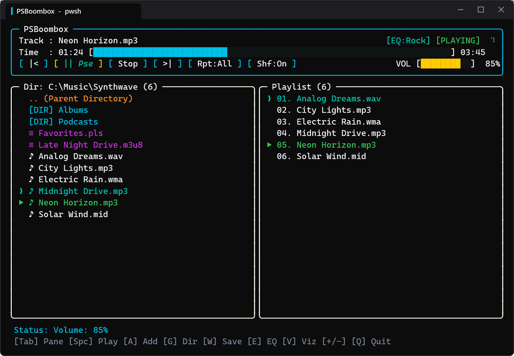
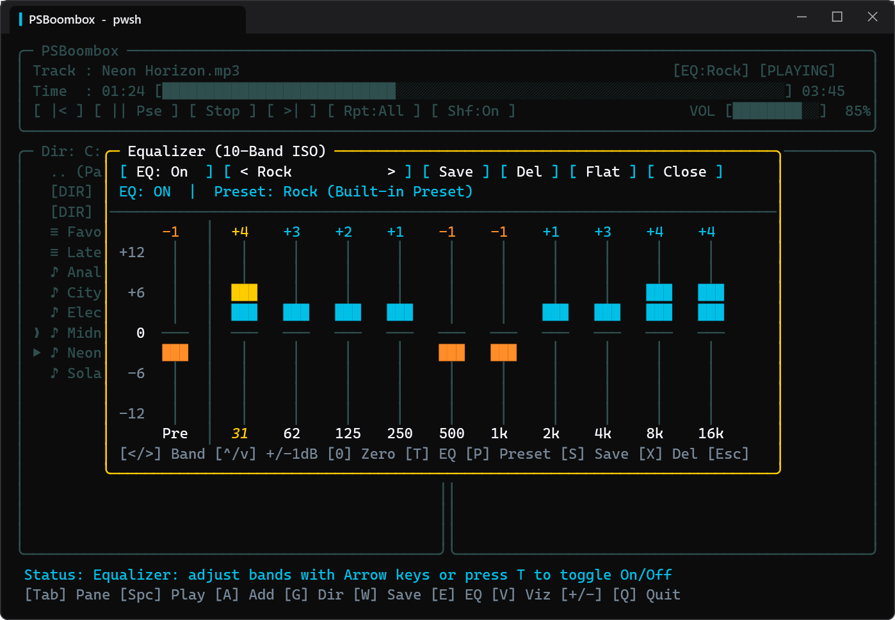

# PSBoombox

A text-based media player for Windows built with PowerShell 7+, featuring a 24-bit TrueColor terminal user interface (TUI), multi-layer finite state machine architecture, playlist file support, and a real-time 10-band ISO graphic equalizer powered by Windows Media Foundation and `winmm.dll`.


---

## Features

- **Native Windows Media Engine & Real-Time 10-Band Equalizer**: Streams `.mp3`, `.wav`, and `.wma` audio in real time through Windows Media Foundation (`mfplat.dll` / `mfreadwrite.dll`), a 10-band peaking biquad equalizer + preamp + soft limiter (`Source/Media/MMEqualizerEngineNative.ps1`), and ring-buffered `winmm.dll` `waveOut*` playback for immediate slider and preset response. MIDI playback (`.mid` / `.midi`) and MCI/mixer interop use pure PowerShell `System.Reflection.Emit` (`DefinePInvokeMethod`) bindings in `MMWinMMNative.ps1`.
- **10-Band ISO EQ + Presets + Persistence**: Includes a Winamp-style `31 Hz`–`16 kHz` equalizer with `-12 dB` to `+12 dB` (`1 dB` steps), preamp slider, 9 built-in presets (`Flat`, `Bass Boost`, `Rock`, `Pop`, `Jazz`, `Classical`, `Vocal`, `Electronic`, `Treble Boost`), unlimited named custom user presets, automatic `Custom` switching on manual edits, and automatic JSON persistence across sessions in `%APPDATA%\PSBoombox\equalizer.json`.
- **Full-Buffer Audio Visualizer Mode (`V`)**: Switches to a full-screen 60 FPS post-EQ visualization canvas (powered by compiled C# ANSI cell-diff rendering and `1 ms` `winmm.dll` timer precision) driven by a real-time 1024-point radix-2 FFT and stereo waveform analyzer, with forward-only `Tab` cycling across five visualizers (**Spectrum Analyzer**, **Mirrored Spectrum**, **Braille Oscilloscope**, **Radial Pulse**, and **Spectrogram Waterfall**).
- **24-Bit TrueColor Synchronized TUI**: Renders rounded box-drawing borders (`╭─╮│╰─╯`), color-coded browser entries, a top-panel EQ active badge (`[EQ:Rock]` / `[EQ:Off]` / `[EQ:MIDI]`), a seekable track progress scrubber, an animated braille activity spinner, and synchronized terminal frame updates (`\e[?2026h` / `\e[?2026l`).
- **Integrated Directory & Playlist Workflow**: Launch directly into your current working directory, automatically queue any supported media files found there, browse folders, append tracks, reorder playlists, toggle repeat/shuffle, and save or load playlists on the fly.
- **Resilient MP3 & Path Handling**: Handles large ID3v2 / embedded album-art tags natively via Media Foundation (with automatic pure PowerShell MPEG frame-sync stripping & short-path staging fallback on MCI error `277` / `268`), cleaning up any temporary staged files on stop and exit.
- **Three-Layer Finite State Machine Design**: Separates application screens (`PBState*`), audio playback lifecycle (`SMPlaybackStateMachine`), and individual UI element focus/activation (`SMUiElementStateMachine`).

---

## System & Software Requirements

| Requirement | Specification |
| --- | --- |
| **Operating System** | **Windows 10 / Windows 11** (`Win32NT`). Windows-only — validated at startup. |
| **PowerShell** | **PowerShell Core 7.0+** (`pwsh`, `Core` edition). Windows PowerShell 5.1 is not supported. |
| **Terminal Emulator** | VT/ANSI terminal with **24-bit TrueColor**, **Unicode** glyph support, and synchronized rendering (**Windows Terminal** with `Cascadia Mono` or `Consolas` recommended). |
| **Terminal Size** | Minimum **80 × 24** cells. Layout scales dynamically from `80 × 24` up to `160 × 50` cells. |
| **Audio Output** | Standard Windows audio output device compatible with Windows `waveOut` / MCI (`winmm.dll`). |
| **Dependencies** | **None.** Zero external executables, NuGet packages, or third-party assemblies. |

---

## Installation & Module Loading

Clone or download the repository to a local directory, then import the module manifest in PowerShell 7 (`pwsh`):

```powershell
Import-Module .\PSBoombox.psd1 -Force
```

To install `PSBoombox` so it can be imported by name from any directory, copy the repository folder into a directory on your `$env:PSModulePath` (for example, `$HOME\Documents\PowerShell\Modules\PSBoombox`):

```powershell
Import-Module PSBoombox
```

---

## Invocation

`PSBoombox` exports a single public cmdlet: `Start-PSBoombox`.

### Parameters

| Parameter | Type | Default | Description |
| --- | --- | --- | --- |
| `-Path` | `[String]` | Current Working Directory | Optional starting directory displayed in the Directory Browser pane (relative or rooted paths supported). |
| `-Playlist` | `[String]` | Empty (`''`) | Optional path to a `.m3u`, `.m3u8`, `.pls`, or `.wpl` playlist file to load on startup. |

### Startup Behavior

- **`Start-PSBoombox`** *(no arguments)*: Opens the Directory Browser in the current working directory (`CWD`), starts with an empty playlist, and automatically appends any supported audio files located in `CWD`.
- **`Start-PSBoombox -Path 'C:\Music'`**: Starts the Directory Browser in `C:\Music` and auto-populates the playlist with any supported audio files found there.
- **`Start-PSBoombox -Playlist '.\Favorites.m3u8'`**: Loads tracks from the specified playlist file on startup (bypassing CWD auto-population) and focuses the Playlist pane automatically when tracks are loaded.

### Examples

```powershell
# Start in the current working directory (auto-adds any media files in CWD)
Start-PSBoombox

# Start in a specific music folder
Start-PSBoombox -Path 'D:\Audio\Synthwave'

# Start with a saved playlist loaded
Start-PSBoombox -Playlist '.\Playlists\LateNight.m3u8'

# Browse one folder while pre-loading a playlist from elsewhere
Start-PSBoombox -Path 'D:\Audio' -Playlist 'D:\Playlists\Favorites.pls'
```

---

## Supported Formats

### Audio Formats

| Extension | Format | Playback Engine & EQ Support |
| --- | --- | --- |
| `.mp3` | MPEG Audio Layer III | Real-time Windows Media Foundation + `waveOut` streaming with full 10-band EQ *(falls back to MPEG frame-sync staging if needed)* |
| `.wav` | RIFF WAVE PCM | Real-time Windows Media Foundation + `waveOut` streaming with full 10-band EQ |
| `.wma` | Windows Media Audio | Real-time Windows Media Foundation + `waveOut` streaming with full 10-band EQ |
| `.mid`, `.midi` | Standard MIDI | Played via Windows MCI (`winmm.dll`); EQ is cleanly bypassed (`[EQ:MIDI]`) |

### Playlist Formats

| Extension | Format | Notes |
| --- | --- | --- |
| `.m3u` | M3U Playlist | Reads and writes `#EXTM3U` / `#EXTINF` entries |
| `.m3u8` | UTF-8 M3U Playlist | Default extension when saving without an extension; writes UTF-8 (without BOM) |
| `.pls` | PLS Playlist | Reads and writes `[playlist]` INI `FileN` / `TitleN` / `LengthN` entries |
| `.wpl` | Windows Media Player Playlist | Reads and writes SMIL XML `<media src="..." />` entries |

Playlist loading resolves relative track paths against the playlist file's directory, supports `file:///` URIs, ignores network stream URLs, and skips missing files while displaying the skipped count in the status bar.

---

## Usage Guide

### Interface Overview

The TUI divides the terminal into four coordinated regions plus centered modal overlays:

1. **Playback Controls (Top Panel, Rows 1–5)**: Displays the active track title, compact equalizer badge (`[EQ:Off]`, `[EQ:<Preset>]`, or `[EQ:MIDI]`), state badge (`[STOPPED]`, `[LOADING]`, `[PLAYING]`, `[PAUSED]`, `[ERROR]`), animated braille activity indicator, seekable track progress bar (`MM:SS`), transport buttons (`|<`, `> Play`/`|| Pse`, `Stop`, `>|`, `Rpt:Off|All|One`, `Shf:Off|On`), and volume/mute indicator (`VOL`/`MUT`).
2. **Directory Browser (Bottom-Left Panel)**: Shows the current path and media file count in the title bar (`Dir: <path> (<count>)`), color-coded by entry type:
   - `.. (Parent Directory)` *(orange)*
   - `[DIR] <Folder>` *(cyan)*
   - `≡ <Playlist>` *(purple)*
   - `♪ <Audio File>` *(white; turns green with `▶` when playing, yellow with `❱` when selected)*
3. **Playlist (Bottom-Right Panel)**: Shows the active playlist name (when loaded/saved) and track count, with `01.` zero-padded track numbering and a green `▶` marker on the active track.
4. **Status & Hint Footer (Bottom Two Rows)**: Displays the latest action status or error message on row 1 and quick keybinding hints on row 2.

---

### Browsing Directories & Building a Playlist

- Use `Up` / `Down` (`PageUp` / `PageDown` / `Home` / `End`) in the **Directory Browser** to highlight items.
- Press `Enter` on `[DIR]` or `.. (Parent Directory)` (or `Backspace` anywhere in the Directory Browser) to change folders.
- Press `Enter` on a playlist entry (`≡ Favorites.pls`) to load it into the **Playlist** pane.
- Press `Enter` on an audio file (`♪ Midnight Drive.mp3`) to add it to the playlist (if not already queued) and start playback immediately.
- Press `A` to append the highlighted audio file to the playlist without interrupting playback, or `Shift+A` to append every supported audio file in the current directory.
- Press `Tab` to move focus to the **Playlist** pane to play (`Enter`), reorder (`U`/`Shift+Up`, `J`/`Shift+Down`), remove (`Delete`/`X`), or clear (`C`) tracks.

---

### Controlling Playback, Seeking & Volume



Press `Tab` (or `Shift+Tab`) to cycle focus to the top **PSBoombox** panel (highlighted with a cyan border):

- **Transport Row**: Use `Left` / `Right` to move between `|<`, `> Play` / `|| Pse`, `Stop`, `>|`, `Rpt:*`, `Shf:*`, and `VOL`. Press `Enter` or `Space` to trigger the focused button.
- **Track Scrubber**: Press `Up` from any transport button to highlight the progress bar, then use `Left` / `Right` to seek backward or forward in **5-second** steps. Press `Down` to return to the transport row.
- **Volume Control**: Move focus to `VOL` and press `Up` / `Down` (or press `+`, `-`, `M` globally from any pane) to adjust volume in **5%** increments or toggle mute (`MUT`). The bar renders green up to 80%, amber above 80%, and red when muted. If MCI per-alias volume commands are unavailable for a given format, `PSBoombox` falls back to Windows wave output volume and restores your original system wave level cleanly on exit.

---

### Jumping Directly to a Directory


Press `G` or `F2` from anywhere in the main screen to open the centered **Go to Directory** modal:

- Type or edit any absolute or relative directory path (up to 260 characters with horizontal scrolling).
- Press `Enter` (or `Tab` to `[ Go ]`) to load the directory, or press `Esc` to cancel.
- Invalid or nonexistent paths report an inline error inside the modal without discarding your input.

---

### Saving Playlists


Press `W` at any time on the main screen to open the **Save Playlist** modal:

- Pre-fills the path using your active playlist's source path or `<CurrentDir>\playlist.m3u8`.
- Enter a filename ending in `.m3u`, `.m3u8`, `.pls`, or `.wpl` (omitting an extension defaults to `.m3u8`).
- Press `Enter` (or select `[ Save ]`) to write the playlist to disk and immediately refresh the Directory Browser listing.

---

### Tuning the 10-Band ISO Equalizer (`E`)



Press `E` from anywhere on the main screen to open the centered **Equalizer (10-Band ISO)** modal while audio continues playing smoothly:

- **On/Off Toggle (`T` or `[ EQ: On/Off ]`)**: Enables or disables equalization in real time and immediately updates the top panel badge (`[EQ:<Preset>]` or `[EQ:Off]`). Your enabled/disabled state is persisted in `%APPDATA%\PSBoombox\equalizer.json` and restored automatically on the next launch.
- **Preamp & 10 ISO Bands (`Pre`, `31 Hz` – `16 kHz`)**: Use `Left` / `Right` to move across `Pre` and all 10 frequency bands, then adjust values from **`-12 dB` to `+12 dB` in `1 dB` steps** (`Up` / `Down`, `PageUp` / `PageDown` for ±3 dB, `Home` / `End` for ±12 dB, or `0` to zero the selected slider). All changes take effect live during playback and automatically switch the active profile to `Custom`.
- **9 Baked-In Presets (`P` / `Shift+P` or `[ < Preset > ]`)**: Cycle through `Flat`, `Bass Boost`, `Rock`, `Pop`, `Jazz`, `Classical`, `Vocal`, `Electronic`, and `Treble Boost`, plus any saved user presets. Press `F` to quickly reset all bands back to `Flat`.
- **Custom Named User Presets (`S` / `X`)**: Press `S` (or select `[ Save ]`) to name and store your current fader curve in `%APPDATA%\PSBoombox\equalizer.json`. All saved custom presets are automatically reloaded on startup alongside your active preset and On/Off setting. Press `X` (or select `[ Del ]`) to remove the active custom user preset.

---

### Visualizer Mode (`V`)


Press `V` from the main Playlist Mode screen to enter full-screen **Visualizer Mode** (`PSBoombox` always starts in Playlist Mode on launch):

- **Active Playback Required**: A decoded audio track (`.mp3`, `.wav`, `.wma`) must be actively playing to enter Visualizer Mode; if stopped or paused, the status bar prompts you to start playback first.
- **MIDI Protection**: Attempting to enter Visualizer Mode while playing a `.mid` / `.midi` track (or advancing to a MIDI track while in Visualizer Mode) displays a centered modal notice explaining that MIDI synthesis does not produce decodable PCM audio buffers.
- **Post-EQ Real-Time Visuals & Layout**: Taps live post-EQ audio from the streaming DSP pipeline across the full canvas (`Rows 1 .. Height - 2`), displaying the currently playing track name in the bottom-left and concise controls on the bottom row.
- **5 Built-In Visualizations (`Tab`)**: Press `Tab` to cycle forward through the visualizers (wrapping cleanly from the last visualization back to the first; reverse `Shift+Tab` cycling is disabled):
  1. **Spectrum Analyzer** *(default)* — Logarithmic vertical FFT bars (`▁`–`█`) with TrueColor gradient and falling peak-hold caps.
  2. **Mirrored Spectrum** — Symmetrical top/bottom frequency bars radiating from the vertical midpoint.
  3. **Braille Oscilloscope** — High-resolution `2 × 4` Unicode Braille waveform plotter with bass-reactive gradients.
  4. **Radial Pulse** — Aspect-corrected concentric expanding rings and starburst field driven by live bass, mid, and treble energy.
  5. **Spectrogram Waterfall** — Scrolling time-frequency heat map rendered at 2× vertical resolution with paired half-blocks (`▀`).
- **Controls & Auto-Return**: Global media controls (`Space`, `N`, `P`, `S`, `+`, `-`, `M`, `R`, `H`, `Q`) remain active while Equalizer/Modal prompts (`E`, `G`, `F2`, `W`) are disabled. Press `V` to return to Playlist Mode at any time, or stop playback (`S` / end of playlist) to return automatically.

---

## Keyboard Shortcuts

### Global Shortcuts (Main Screen)

| Key | Action |
| --- | --- |
| `Tab` / `Shift+Tab` | Cycle focus pane (`Directory Browser` ↔ `Playlist` ↔ `Playback Controls`) |
| `Space` | Toggle Play / Pause *(when focused on a Playback Control button, activates that button)* |
| `N` / `P` | Play Next / Previous track |
| `S` | Stop playback |
| `R` | Cycle Repeat mode (`Off` → `Playlist` (`Rpt:All`) → `Track` (`Rpt:One`)) |
| `H` | Toggle Shuffle (`Off` / `On`) |
| `+` / `-` | Increase / decrease volume by 5% |
| `M` | Toggle Mute |
| `E` | Open **Equalizer (10-Band ISO)** modal |
| `V` | Enter **Visualizer Mode** *(requires playing non-MIDI audio track)* |
| `G` / `F2` | Open **Go to Directory** modal |
| `W` | Open **Save Playlist** modal |
| `Q` / `Esc` | Quit PSBoombox cleanly |

### Directory Browser (`Tab` → Left Pane)

| Key | Action |
| --- | --- |
| `Up` / `Down` | Move selection up / down (wraps around) |
| `PageUp` / `PageDown` | Scroll one page up / down |
| `Home` / `End` | Jump to first / last entry |
| `Enter` | Open folder, load playlist file, or add & play audio track |
| `Backspace` | Navigate to parent directory |
| `A` | Add highlighted audio file to playlist |
| `Shift+A` | Add all supported audio files in current directory to playlist |

### Playlist Pane (`Tab` → Right Pane)

| Key | Action |
| --- | --- |
| `Up` / `Down` | Move selection up / down |
| `PageUp` / `PageDown` | Scroll one page up / down |
| `Home` / `End` | Jump to first / last track |
| `Enter` | Play selected track |
| `U` / `Shift+Up` | Move selected track up |
| `J` / `Shift+Down` | Move selected track down |
| `Delete` / `X` | Remove selected track from playlist |
| `C` | Clear entire playlist and stop playback |

### Playback Controls (`Tab` → Top Pane)

| Focus Row / Control | Key | Action |
| --- | --- | --- |
| Transport Row (`|<` .. `VOL`) | `Left` / `Right` | Cycle focus across buttons and Volume control |
| Transport Buttons (`|<` .. `Shf:*`) | `Up` | Move focus up to the Track Scrubber |
| Transport Buttons (`|<` .. `Shf:*`) | `Enter` / `Space` | Activate focused button |
| Track Scrubber | `Left` / `Right` | Seek backward / forward by 5 seconds |
| Track Scrubber | `Down` | Move focus down to `[ > Play ]` / `[ || Pse ]` |
| Volume Control (`VOL`) | `Up` / `Down` | Adjust volume by ±5% *(M mutes)* |

### Modal Dialogs (`Go to Directory` / `Save Playlist`)

| Key | Action |
| --- | --- |
| Printable characters | Insert text at cursor (up to 260 characters) |
| `Left` / `Right` / `Home` / `End` | Move text cursor within the input field |
| `Backspace` / `Delete` | Delete character before / at cursor |
| `Tab` / `Shift+Tab` | Cycle focus between Path Input, Confirm button, and `Cancel` |
| `Enter` | Submit modal (or invoke focused button) |
| `Esc` | Cancel modal and return to Main Screen |

### Equalizer Modal (`E`)

| Key | Action |
| --- | --- |
| `Tab` / `Shift+Tab` | Switch focus between Fader Bank (`Pre`, `31`–`16k`) and Top Control Buttons |
| `Left` / `Right` | Select slider band or navigate top buttons |
| `Up` / `Down` | Adjust focused slider by **±1 dB** (`-12 dB` to `+12 dB`) |
| `PageUp` / `PageDown` | Adjust focused slider by **±3 dB** |
| `Home` / `End` | Jump focused slider to `+12 dB` / `-12 dB` |
| `0` / `Delete` | Reset focused slider to `0 dB` |
| `T` | Toggle Equalizer On / Off *(persisted to `%APPDATA%\PSBoombox\equalizer.json`)* |
| `P` / `Shift+P` *(or `]` / `[`)* | Cycle forward / backward through built-in and custom user presets |
| `S` | Save current slider settings as a custom named preset *(Enter saves, Esc cancels name entry)* |
| `X` | Delete the currently active user preset *(built-in presets are protected)* |
| `F` | Reset all bands to `Flat` (`0 dB`) |
| `E` / `Esc` | Close Equalizer modal *(or select `[ Close ]`)* |

### Visualizer Mode (`V`)

| Key | Action |
| --- | --- |
| `Tab` | Advance forward to the next visualizer *(loops back to first after last; no reverse cycling)* |
| `V` | Exit Visualizer Mode and return to Playlist Mode |
| `Space` | Toggle Play / Pause |
| `N` / `P` | Play Next / Previous track |
| `S` | Stop playback and automatically return to Playlist Mode |
| `+` / `-` / `M` | Adjust volume ±5% or toggle Mute |
| `R` / `H` | Cycle Repeat mode / Toggle Shuffle |
| `Q` | Quit PSBoombox cleanly |

---

## Architecture & Project Structure

`PSBoombox` loads its subsystems in strict dependency order inside [`PSBoombox.psm1`](PSBoombox.psm1):

```text
PSBoombox/
├── PSBoombox.psd1                 # Module manifest (PowerShell 7.0 Core, exports Start-PSBoombox)
├── PSBoombox.psm1                 # Ordered module loader
├── Public/
│   └── Start-PSBoombox.ps1        # Public entry command (-Path, -Playlist)
├── Source/
│   ├── Color/ & String/           # 24-bit TrueColor library & AT* ANSI control sequence builders
│   ├── Engine/
│   │   ├── AppCore.ps1            # Frame loop, delta timing, async ConsoleKeyInfo runspace
│   │   ├── BoomboxCore.ps1        # Coordinates panels, media services, visualizers, focus zones & actions
│   │   └── States/                # PBStateInit, PBStateMainPlayer, PBStateVisualizer, PBStateEqualizer, PBStateNoticeModal, PBState*Prompt, PBStateShutdown
│   ├── Enums/ & Events/ & Util/   # Focus zones, repeat/playback enums, Janitor environment checks
│   ├── Media/
│   │   ├── MMWinMMNative.ps1      # Pure Reflection.Emit P/Invoke for winmm.dll MCI, timer & kernel32.dll
│   │   ├── MMEqualizerEngineNative.ps1 # Scoped Add-Type exceptions: 60 Hz Media Foundation/waveOut EQ + FFT & 60 FPS visualizer canvas/renderer
│   │   ├── MMEqualizerPreset.ps1  # Equalizer preset model & band normalization
│   │   ├── MMEqualizerService.ps1 # 9 built-in presets, custom user presets & equalizer.json persistence
│   │   ├── MMMediaPlayer.ps1      # Hybrid Media Foundation (EQ/FFT) + MCI (MIDI) playback controller
│   │   ├── MMDirectoryService.ps1 # Filesystem browsing & audio/playlist enumeration
│   │   ├── MMPlaylist.ps1         # Queue operations, RepeatMode & Shuffle logic
│   │   └── MMPlaylistFileService.ps1 # Reader & writer for .m3u, .m3u8, .pls, and .wpl
│   ├── StateMachine/              # Generic SMStateMachine, SMUiElementStateMachine, SMPlaybackStateMachine
│   └── UI/
│       ├── Elements/*             # Controls including UIVerticalSlider, UITrackProgressBar, UIVolumeControl
│       ├── Panels/*               # Panels & modals including UIEqualizerModal, UINoticeModal, UIPathInputModal
│       └── Visualizers/*          # Double-buffered UIVisualizerCanvas & 5 visualizers (Spectrum, Mirror, Oscilloscope, RadialPulse, Waterfall)
└── Tests/
    ├── Run-PSBoomboxTests.ps1     # Automated unit, DSP, FFT, persistence, integration & style audit suite
    └── Test-Helpers.ps1           # Synthetic WAV / MP3 generators and assertions
```

---

## Running Tests

Run the automated test suite from the repository root using PowerShell 7 (`pwsh`):

```powershell
pwsh -NoProfile -File .\Tests\Run-PSBoomboxTests.ps1
```

The test harness validates 13 test suites covering:
1. Module manifest metadata, `Core` edition enforcement, and `Start-PSBoombox` parameter exports.
2. Coding standard and pure native PowerShell compliance across all files under `Source/` and `Public/` (verifying `Add-Type` is used exclusively inside `Source/Media/MMEqualizerEngineNative.ps1`, `Set-StrictMode -Version Latest`, and `ColorLibrary` rules).
3. UI, Playback, and Application finite state machine transitions.
4. Live Windows Media Foundation + `winmm.dll` `waveOut` playback, pause, resume, seek, volume/mute, and natural end-of-track events.
5. Real-world MP3 playback edge cases including large ID3v2 / album-art padding and deep paths plus temporary staged-file cleanup.
6. Directory browsing, all startup modes (`CWD`, `-Path`, `-Playlist`), and round-trip `.m3u`, `.m3u8`, `.pls`, and `.wpl` serialization.
7. Playlist queue mutations, reordering, repeat modes, and shuffle navigation.
8. Headless engine simulation of focus cycling, directory/save/equalizer modals (`E`, `T`, `UpArrow`, `S`, top `[EQ:...]` badge), and clean shutdown.
9. 10-band biquad EQ DSP frequency response (`62 Hz` boost, `4 kHz` cut, bypass when disabled, and soft-limiter output bounds).
10. Equalizer preset management (`9` built-in profiles, custom named user presets, built-in protection, and `equalizer.json` startup persistence).
11. 1024-point FFT audio analysis (`100 Hz` bass bin vs. `4 kHz` treble bin separation) and post-EQ spectrum reactivity.
12. Visualizer Mode state machine flow (stopped guard, MIDI notice modal, live `.wav` entry, bottom-left track label, forward-only `Tab` wrap cycling, `E` lockout, global volume/mute, `V` exit, and stop auto-return).
13. 60 FPS visualizer pacing (`TargetFps` switching, `winmm.dll` 1 ms timer P/Invoke), `AudioAnalyzer` FFT version caching, native cell-diff emission, and `< 10 ms/frame` render budget at `160×48`.
